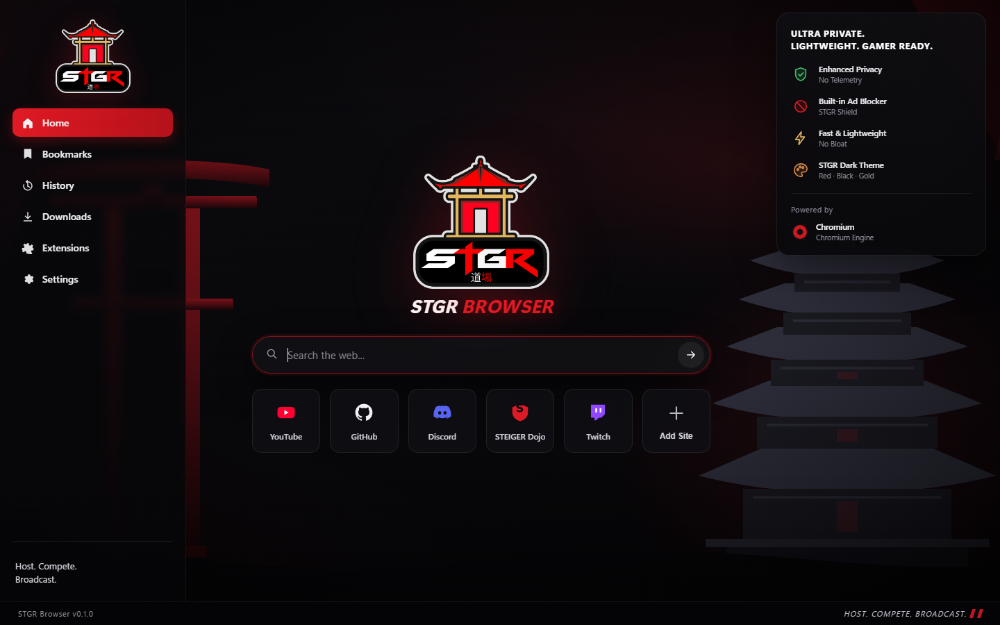

# STGR Browser

A Chromium-based browser for people who want a fast, quiet, low-memory window onto the web.
Host. Compete. Broadcast.



*The shipped New Tab Page. The full window — tab strip, toolbar, link rail — is
[design/preview.png](design/preview.png); the chrome portion is Stage 2 work.*

---

## What this repository is

STGR Browser is a **Chromium distribution**, not a Chromium fork. The build pipeline
takes a pinned upstream Chromium build, applies STGR branding, seeds a hardened default
profile, bundles three extensions, and produces a signed-ready Windows installer — all
inside GitHub Actions. Nothing is compiled on a developer machine.

That choice is deliberate and it is the single most important thing to understand about
this project. See [ADR-0002](docs/decisions/ADR-0002-build-strategy.md) for the reasoning,
including the hard limits of hosted CI runners.

| | Stage 1 (shipped today) | Stage 2 (planned) |
|---|---|---|
| Engine | Pinned upstream Chromium binary | Chromium built from source with STGR patches |
| Branding | Icons, version resources, installer, window chrome colours | Compiled-in product strings, custom toolbar and sidebar |
| Privacy | Launch flags + `initial_preferences` + per-user policies | Patched defaults, telemetry code removed at the source |
| Build host | `windows-latest` runner, ~20 min | Self-hosted 32-core / 64 GB runner, ~5 h |
| Installer | NSIS `.exe`, per-user, no UAC | Same, plus code signing |

Stage 1 is fully automated and produces a working browser. Stage 2 is what turns it into a
product you can hand to strangers; the patch scaffolding and the runner recipe are in
[`patches/`](patches/) and [docs/ROADMAP.md](docs/ROADMAP.md).

---

## What you get today

- **Chromium engine** — full web compatibility, Manifest V3 extension support, Chrome Web Store works.
- **No telemetry** — three independent layers (flags, preferences, enterprise policy) all
  switched off. [Details](docs/PRIVACY.md).
- **Network-level ad and tracker blocking** — rules are compiled at build time into
  `declarativeNetRequest` rulesets, so blocking happens before a socket opens and costs no
  per-page JavaScript. [Details](extensions/stgr-shield/README.md).
- **Low memory by default** — aggressive tab discarding plus a curated flag set, with an
  opt-in `Low RAM` shortcut that trades process isolation for another ~30% memory.
  [Details](docs/PERFORMANCE.md).
- **Custom New Tab Page** — speed dial, private search, zero network calls.
- **Installer** — per-user, no administrator prompt, `stgr://` protocol handler, clean uninstall.

---

## Build it

Builds run in CI only. Locally you only ever run validators.

```bash
# validate everything CI validates
python -m compileall -q scripts branding
python scripts/check-brand.py
python scripts/gen-ntp-config.py
python scripts/build-shield-rules.py --offline
node --check ntp/app.js

# see the exact switches the browser will launch with
python scripts/build.py --print-flags balanced
python scripts/build.py --print-flags lowmem
```

### Cut a release

```bash
# 1. bump the version
echo "0.2.0" > VERSION
python scripts/gen-ntp-config.py     # syncs ntp/manifest.json
git commit -am "release: 0.2.0"
git tag v0.2.0
git push origin main --tags
```

The `build-windows` workflow builds the installer and publishes it to GitHub Releases with
a checksum file. Nothing else to do. Full process: [docs/RELEASE.md](docs/RELEASE.md).

---

## Repository map

```
branding/          brand.json (single source of truth), icon pipeline, master logo
config/            base.json (pinned engine), preferences, policies, flags, blocklists
extensions/        stgr-shield (ad blocking), stgr-theme (chrome colours)
ntp/               the New Tab Page - a standalone MV3 extension
overrides/windows/ NSIS installer script and wizard art
scripts/           build.py and the codegen/validation helpers
patches/           Stage 2 Chromium source patch series (scaffolded)
docs/              architecture, build, performance, privacy, ADRs, agent handoff
```

---

## Documentation

| Document | Read it when |
|---|---|
| [AGENTS.md](AGENTS.md) | You are an AI agent picking this up. Start here. |
| [docs/ARCHITECTURE.md](docs/ARCHITECTURE.md) | You need to know how the pieces fit together |
| [docs/BUILD.md](docs/BUILD.md) | A build failed, or you need to change the pipeline |
| [docs/PERFORMANCE.md](docs/PERFORMANCE.md) | You are touching flags, prefs, or memory behaviour |
| [docs/PRIVACY.md](docs/PRIVACY.md) | You are touching anything network-related |
| [docs/RELEASE.md](docs/RELEASE.md) | You are cutting a version |
| [docs/ROADMAP.md](docs/ROADMAP.md) | You are planning Stage 2 |
| [docs/decisions/](docs/decisions/) | You want to know *why*, before changing something |

---

## Licence

STGR-authored code is MIT. Chromium components remain BSD-3-Clause. See [LICENSE](LICENSE)
and [NOTICE](NOTICE).
